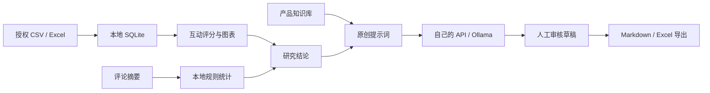

# ✦ 别再凭感觉写笔记！小红书 AI 爆文研究室

### 把热门内容变成研究素材，把用户需求变成原创灵感

**XHS Insight Studio** 是面向 Windows 用户的本地内容研究工具：整理笔记互动数据、研究评论需求、保存产品资料，再通过自己的 AI 服务生成待审核文案。无需自建服务器。

> 源码公开供学习与个人使用。仅作者或获得作者书面授权的销售者可以销售软件。详见 [LICENSE](LICENSE)。本项目采用限制商业分发的自定义许可，并非 OSI 标准开源许可。

### 一张图看懂



### 已经可以做什么？

| 模块 | 能力 |
| --- | --- |
| 数据研究 | CSV / XLSX 导入、关键词筛选、互动排序、图表、Excel 导出 |
| 评论研究 | 本地关键词分类、手机号与邮箱基础脱敏 |
| 产品知识库 | 保存名称、价格、卖点、目标用户与禁用词 |
| 原创创作 | 五种创作提示词、兼容 API / Ollama、生成后编辑保存 |
| 草稿管理 | 待审核 / 已采用 / 已发布，Markdown 下载 |

### 给普通用户

从本仓库 Releases 获取 Windows 压缩包，完整解压后双击 `XHS_Insight_Studio.exe`，浏览器打开本地工作台。无需 GitHub 账号、无需安装 Python。关闭启动器窗口即可停止服务。

AI 模式由用户自备模型和密钥，服务商可能收费；无需 AI 时仍可导入、分析和导出提示词。软件不内置作者密钥。

### 从源码启动

当前验证环境为 Windows / Python 3.13。在项目目录运行：

```powershell
python -m venv .venv
.venv\Scripts\python -m pip install -r requirements.txt
.venv\Scripts\python qidong.py
```

### 三分钟上手

1. 在“笔记导入与分析”下载模板，用自己的授权数据替换虚构示例。
2. 查看互动分与图表，整理研究结论。
3. 在产品知识库录入真实商品资料。
4. 系统设置填写模型；API 地址通常以 `/v1` 结束，Ollama 地址例如 `http://localhost:11434`。
5. 创作页面确认发送资料，再生成、编辑、保存和导出。

### 数据与隐私

数据默认保存到 `%LOCALAPPDATA%\XHSInsightStudio\insight.db`，升级前可备份整个目录。密钥仅保留当前会话内存。AI 调用会将所选产品资料和研究摘要发送至用户配置的服务；基础脱敏不能替代人工检查。

### 指标说明

互动分 = 点赞 + 收藏 × 2 + 评论 × 3，仅用于当前样本内排序，不代表流量预测或爆款概率。没有曝光数据不计算收藏率。评论分类是可重叠的关键词规则，不是 AI 聚类。重复导入会追加数据。

### 开发与打包

```powershell
.venv\Scripts\python -m pytest -q
powershell -ExecutionPolicy Bypass -File dabao.ps1
```

### 版本边界

当前为 0.1.0 体验版本：没有自动采集、自动发布、付费版本分层或离线授权码验证。销售限制来自许可条款，不是防破解技术。只使用自有或获授权的数据，生成内容需人工核实，不保证爆款或收益。本项目与小红书官方无关联。

### 授权与销售

允许个人学习、研究、修改以及用于自己的日常内容运营。未经作者书面授权，不得销售、转售、付费分发本软件或其修改版，不得将其打包为付费服务。授权咨询请在本仓库创建 Issue，不要公开密钥或客户信息。

### 致谢

本项目自行编写业务代码与上方 Mermaid 流程图，未复制其他成品项目代码、模板截图或品牌素材。依赖感谢 [Streamlit](https://github.com/streamlit/streamlit)、[SQLAlchemy](https://github.com/sqlalchemy/sqlalchemy)、[pandas](https://github.com/pandas-dev/pandas)、[openpyxl](https://openpyxl.readthedocs.io/)、[Requests](https://github.com/psf/requests)、[PyInstaller](https://github.com/pyinstaller/pyinstaller) 与 [pytest](https://github.com/pytest-dev/pytest)。第三方组件适用各自许可，发行包保留相关许可证。

### 如果它帮到了你

欢迎点一个 ⭐ Star，也欢迎通过 Issue 提交建议。请勿在 Issue 上传未经授权的笔记、评论或个人信息。
